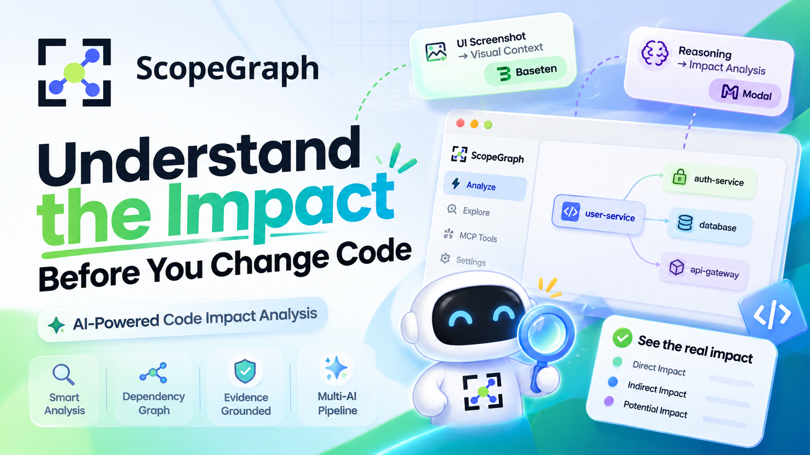
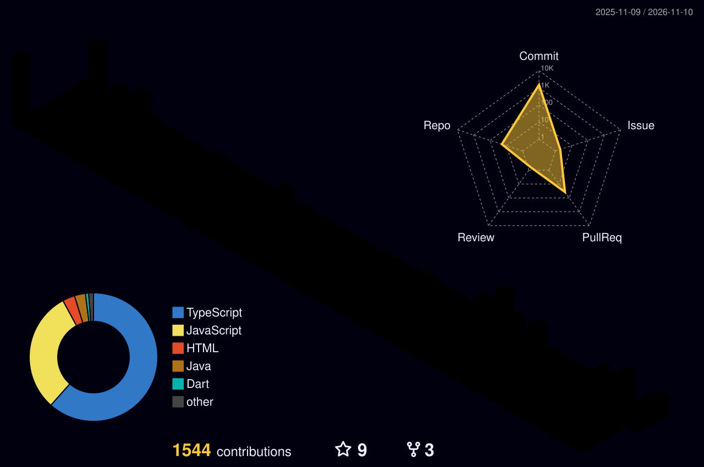

<div align="center">
  
</div>

<div align="center">
  
</div>

<br/>

<div align="center">
  
  
  
  
</div>

<br/>

##  About Me

```typescript
const tee = {
    pronouns: "He" | "Him",
    location: "Vietnam 🇻🇳",
    code: ["Java", "JavaScript", "TypeScript", "Python", "HTML/CSS"],
    technologies: {
    backEnd: {
        java: ["Spring Boot", "Spring Data JPA", "RESTful API", "JWT Authentication"],
        javascript: ["Node.js", "Express.js", "RESTful API", "Socket.IO"],
        python: ["OpenCV", "YOLO", "AI/ML"]
    },
    frontEnd: {
        js: ["React", "Vite", "JavaScript (ES6+)", "AJAX"],
        css: ["Tailwind CSS", "Bootstrap", "Responsive Design"]
    },
    databases: ["MySQL", "MongoDB", "SQL Server", "FireBase"],
    tools: ["Git", "GitHub", "Postman"]
},
    currentFocus: "Full Stack Web Development & AI Integration",
    funFact: "Mình có thể code cả ngày với một chiếc MÁC BÚC PRO"
};
```

<br/>

##  Tech Stack

<div align="center">

### Languages


### Frameworks & Libraries


### Databases


### Tools


### IDEs & Editors


</div>

<br/>

##  GitHub Analytics

<p align="center">
  
</p>

<br/>

## 🔥 Outstanding project

Four projects I'm most proud of — AI, 3D games, and computer vision.

<table>
<tr>
<td width="50%" valign="top">


#### [🔍 Findora](https://github.com/teehihi/findora-new)


AI-powered lost & found app: Gemini analyses photos and drafts posts, a map to search nearby, and matching that pairs lost reports with found reports so belongings find their way home.

   

🔗 [findora-new](https://github.com/teehihi/findora-new)

</td>
<td width="50%" valign="top">



#### [🕸️ ScopeGraph](https://github.com/teehihi/scope-graph)


AI-powered code impact analysis: map a change request onto the dependency graph, pinpoint affected files and symbols with code evidence, and expose it to coding agents via MCP.

  

🔗 [scope-graph](https://github.com/teehihi/scope-graph) · 🌐 [Live Demo](https://www.scopegraph.top/)

</td>
</tr>
<tr>
<td width="50%" valign="top">

#### [🌀 SCAMMAZE](https://github.com/teehihi/scam-maze)


First-person 3D game about spotting scams: live an ordinary day in District 4, get a suspicious call on your in-game phone, investigate the clues, then decide.

  

🔗 [scam-maze](https://github.com/teehihi/scam-maze) · 🌐 [Live Demo](https://teehihi.github.io/scam-maze/)

</td>
<td width="50%" valign="top">

#### [🔥 PhoenixVision Fire Detection](https://github.com/teehihi/phoenix-vision-fire-detection)


Real-time fire alert system: YOLO detects fire and smoke from camera feeds, with a dashboard to monitor and alert in time.

   

🔗 [phoenix-vision-fire-detection](https://github.com/teehihi/phoenix-vision-fire-detection)

</td>
</tr>
</table>

<br/>

## 🌟 Open Source Contributions

Merged contributions to open-source projects maintained by others.

#### VoiceStudio

[](https://github.com/debpalash/VoiceStudio/pull/3834) [](https://github.com/debpalash/VoiceStudio)

The open-source, fully-local ElevenLabs alternative — voice cloning, voice design, video dubbing, dictation, transcription & audiobook creation in 646 languages.

**Contribution:** Fixed dub misclassifying unlisted language tags as another language (Filipino `fil` became Finnish, Estonian became Spanish). Replaced the two-letter truncation with a proper BCP-47 lookup — unknown tags now return `None` instead of silently becoming a different language.

**Pull Request:** [fix(dub): stop turning unlisted language tags into another language (#3834)](https://github.com/debpalash/VoiceStudio/pull/3834) — Merged Nov 7, 2026

<br/>

##  Contact With Me

<div align="center">

[](https://facebook.com/nhatthien.nguyen.566)
[](https://www.tiktok.com/@tee.hihi)
[](https://linktr.ee/nkqt-tee)
[](mailto:teeforwork21@gmail.com)

</div>

<br/>

## 📈 GitHub Stats

<div align="center">
<table>
<tr>
<td width="50%">
  
</td>
<td width="50%">
  
</td>
</tr>
</table>
</div>

<br/>

## 📊 Contribution Activity

<div align="center">
  


</div>
<div align="center">
  
</div>
<div align="center">
  
</div>
